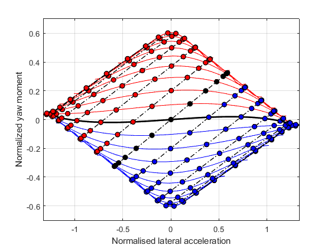

# yaw_moment_diagrams

This code calculates the yaw moment and beta diagrams for a bicycle model on a 3d track.

## Explained:
This program demonstrates via a bicycle model how optimal control can be used to calculate yaw moment diagrams.
This method has significant advantages over traditional point-by-point calculation techniques.

## Features:
* A simple combined slip tire model
* Several additional outputs, including stability and yaw-damping derivatives.

## How to use:
* The code is run from BicycleYMDMain.m
* BicycleYMDDAE.m has most of the relevant dynamic equations.
* BicycleYMDContinuous.m predominantly hosts BicycleYMDDAE.m
* BicycleYMDEndpoint.m sets the objective to minimize.
* DFyAlf.m provides the instantaneous cornering stiffness of a tire with a slip input.
* [GPOPS-II](https://www.gpops2.com/) must be installed to solve the optimal control problem.
  * For information about configuring the optimal control problem, please refer to the user manual available on their website.
* [ADiGator](https://github.com/matt-weinstein/adigator) must also be installed to calculate the derivative files.

## Information
* Extensive information and references can be found in our paper published in [Vehicle System Dynamics](https://www.tandfonline.com/doi/full/10.1080/00423114.2025.2471344?src=exp-la#d1e138)

## Authors
* [Professor David JN Limebeer](https://scholar.google.com/citations?user=FaVnBlIAAAAJ&hl=en&oi=sra)
* Richard D. Leyton-Romero
* [Professor Matteo Massaro](https://scholar.google.it/citations?user=4-tQq6cAAAAJ&hl=en)

## Referencing
To cite this work:

Limebeer, D. J. N., Leyton Romero, R. D., & Massaro, M. (2025). An optimal control approach to the generation of yaw-moment diagrams. _Vehicle System Dynamics_, 1–25. https://doi.org/10.1080/00423114.2025.2471344
